# Alpha architecture

The executable delegates to repository operations in `src/core.ts`. `src/delivery.ts`, `src/discovery.ts`, and `src/all.ts` assemble standalone bundles from the text sources under `schemas/`, using the shared loader and guidance in `src/schema-source.ts`. The combined workflow uses native skip_specs metadata for no-delivery outcomes and checks its small decision contract before product evidence. The package exposes only public OpenSpec schema/configuration surfaces.

```mermaid
flowchart LR
    CLI[Cliewen CLI] --> Installer[Transactional installer]
    Installer --> Schema[Delivery schema and templates]
    Schema --> Change[OpenSpec change]
    Change --> Tests[Repository tests]
    Tests --> Adapter[Node reference adapter]
    Adapter --> Report[Revision-bound evidence report]
    Report --> Check[Cliewen check]
    Check --> Review[Human or agent assertion review]
    Review --> Archive[OpenSpec archive]
```

The installer journals content before writes and owns schema/template files through a hash manifest. Project configuration, ID registry and authored documents belong to the adopter. It preserves the default schema unless `--default` is explicitly requested.

The evidence report is generated output, ignored by Git. The adapter checks clean inputs before and after tests and includes runner exit status. The checker compares the full revision, inspects working-tree changes and resolves scenario references. It reports execution/linkage separately from the assertion review that still requires judgment.

Archive changes the tree and produces a new candidate revision. Re-run tests after committing the archived state before reporting permanent-spec evidence as current. No post-implementation report is an apply prerequisite.

See [evidence conventions](../testing/evidence.md) and [the shared-base decision](../decisions/001-shared-base-and-schemas.md).
