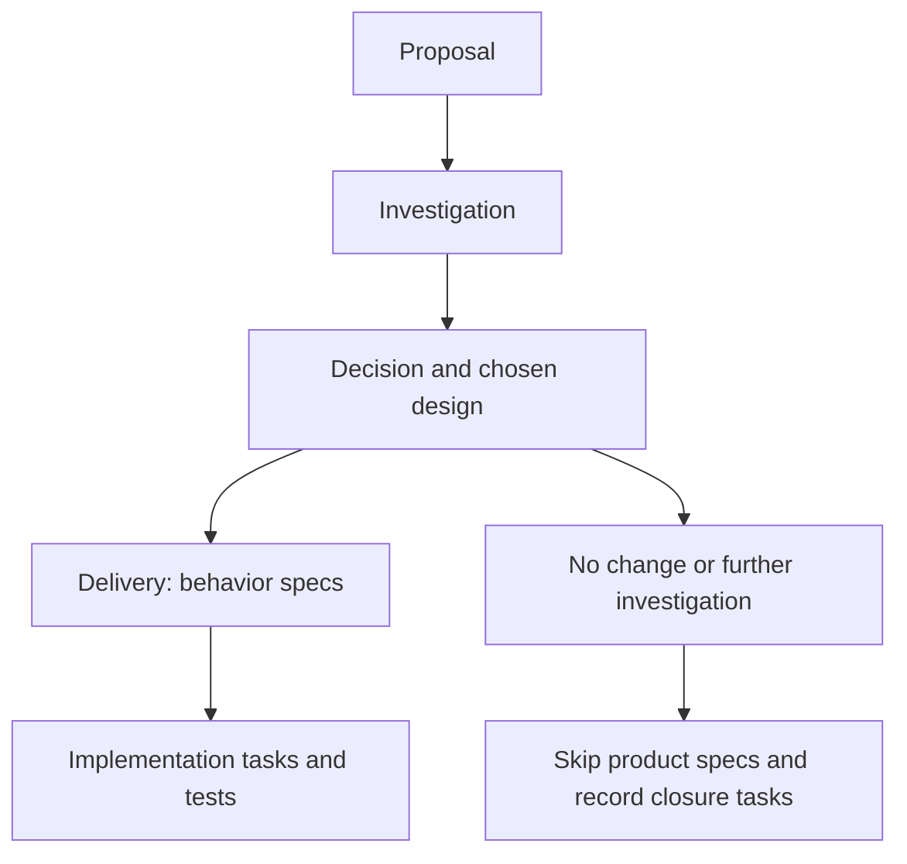

# Investigate and deliver in one change

Choose `cliewen-all` when a change needs investigation before you can specify its behavior, and you want to keep the resulting delivery in the same change. For investigation alone, use [discovery](discovery.md); for an understood change, use [delivery](workflow.md).

`init` installs all three schemas. `init --default` still selects delivery. Start a combined change explicitly:

```sh
npx --no-install openspec new change improve-export --schema cliewen-all
npx --no-install openspec instructions proposal --change improve-export --json
```

For example:

> Investigate whether CSV export needs an optional encoding marker. Use `cliewen-all` in `improve-export`. Compare API choices and preserve existing output by default. Record actual observations and uncertainty. Recommend an outcome and stop for my review before implementation. Keep one proposal and use decision.md for the chosen approach.

## One explanation for each purpose



The fixed artifact graph is proposal → investigation → decision → specs → tasks. The decision also holds the design; there is no separate `design.md`. Update the existing proposal after investigation and link observations instead of repeating them. This schema does not create a second delivery change or change its schema mid-workflow.

The decision has explicit frontmatter:

```yaml
---
type: decision
status: proposed
outcome: delivery
---
```

`outcome` is `delivery`, `no-change`, or `further-investigation`. `status` is `proposed` until human agreement, then `accepted`. The agent records the real approval source. File completion or an agent-written `accepted` value cannot prove that agreement occurred.

## Continue with delivery

For `outcome: delivery`, keep native `skip_specs` absent or false in the change's `.openspec.yaml`. Write the behavior deltas using the decision's chosen approach. Then write small implementation tasks with their concrete tests, types, boundaries, and configured testing order. The defaults remain per-task and flexible; optional TDD is unchanged.

The agent may prepare draft specs or tasks for review while the decision is proposed, with new acceptance IDs left unassigned. It must preserve product inputs, capability mappings, and the AC registry until human agreement is recorded. Then set `status: accepted` with its source and allocate IDs through the CLI before delivery. Request apply instructions:

```sh
npx --no-install openspec instructions apply --change improve-export --json
```

Finish implementation, documentation, task notes, and any PR draft, then commit the inputs and collect evidence for the same change:

```sh
node node_modules/cliewen-openspec/adapters/node-test.mjs --change improve-export test/export.test.mjs
npx --no-install cliewen-openspec check --change improve-export --json
```

Cliewen checks the decision fields and accepted status, then runs the ordinary delivery evidence checks. It rejects a delivery outcome with skipped specs. The CLI cannot determine who changed a status field or prevent code edits made outside its commands. Review the approval record and actual implementation.

Any later commit, including documentation-only changes, requires recollection and another check on the final revision. See [evidence collection](../testing/evidence.md). Implementation agreement and a passing check do not authorize archive, push, or opening an external PR; follow the scope actually granted.

## Finish without product changes

For `outcome: no-change` or `further-investigation`, retain the reason, remaining uncertainty, and conditions for reopening the question. Set native `skip_specs: true` in `.openspec.yaml`, preserving its other fields:

```yaml
schema: cliewen-all
skip_specs: true
```

OpenSpec 1.15.0 marks the specs artifact skipped and unlocks tasks. Do not create fake specs or allocate product acceptance IDs for unanswered questions. The schema graph stays fixed; native metadata controls the skipped artifact, rather than Cliewen feature flags rewriting dependencies.

`tasks.md` records only real closure work, for example:

```markdown
- [ ] Review the recommendation and unresolved questions.
- [ ] Retain useful observations and clean up temporary experiments.
```

No implementation or product test tasks are required for that outcome. No product evidence report is needed. Run:

```sh
npx --no-install cliewen-openspec check --change improve-export --json
```

The check verifies decision metadata, the skip marker, absence of Markdown product deltas, installation, and registry health. It reports `discovery-review-required`. An `ok: true` result does not certify the research, approve the recommendation, or verify that closure task descriptions are appropriate.

After human review and authorized closure:

```sh
npx --no-install openspec archive improve-export --skip-specs --yes
```

For completed delivery, use normal OpenSpec archive, then commit and regenerate evidence without `--change` before checking permanent specs. The [delivery guide](getting-started.md#7-archive-and-refresh-evidence) covers those commands.

## Configuration and limitations

The schema shares configuration, writing and diagram guidance, stable IDs, test types, and evidence with the other workflows. Disabling decisions removes optional extra durable-record work; it does not remove the decision artifact or approval boundary. Disabling evidence skips product execution checks, but outcome metadata, skip consistency, and the accepted-status check still apply.

Only the small decision/branch contract is structurally checked. Source quality, reasoning, actual human agreement, and correct execution order require review. OpenSpec may show artifacts complete or apply ready before acceptance; that is file readiness, not authorization. If a no-delivery change later becomes delivery, obtain agreement, update its outcome, clear `skip_specs`, and create real specs/tasks before implementation. Do not use skipped specs to bypass verification.
