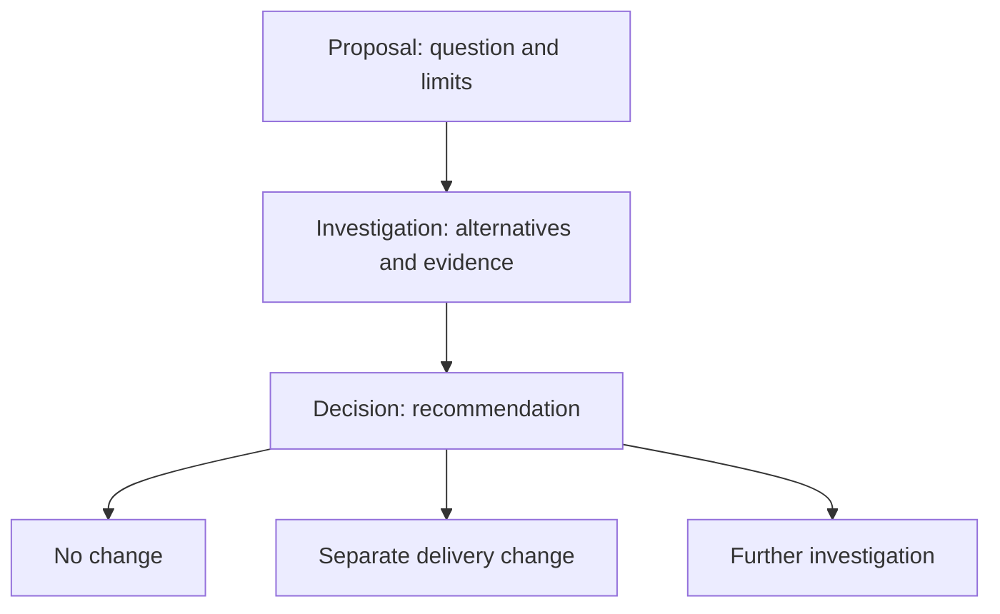

# Investigate before choosing a change

Use `cliewen-discovery` when you need to understand a problem or compare alternatives before committing to implementation. It produces a proposal, an investigation, and a recommendation. A useful outcome can be to keep the current system.

`init` installs discovery alongside delivery. Delivery remains the default selected by `init --default`; choose discovery explicitly for a new investigation:

```sh
npx --no-install openspec new change investigate-cache --schema cliewen-discovery
npx --no-install openspec instructions proposal --change investigate-cache --json
```

For example, give your coding agent this request:

> Investigate whether we need a cache for our current workload. Use the existing discovery change `investigate-cache`. Compare keeping the current path with adding a cache. Start with existing code and available measurements; ask before running costly experiments. Record sources, actual observations, and uncertainty. Produce a recommendation and stop for my review before production changes or archive. Keeping the current system is a valid outcome.

## What the agent writes



The proposal states the question, scope, decision criteria, and investigation limits. The investigation compares alternatives and separates facts, hypotheses, actual results, and uncertainty. Experiments are optional. When one is run, record the command or method, inputs or revision, outcome, and limitations. If an experiment was not run, say so.

The decision explains the recommendation and links to its evidence. It starts with `status: proposed`; only human agreement permits acceptance. It identifies a delivery handoff, no change, or further investigation. For no change, explain why and what would reopen the question.

The schema requires these three artifacts in order. OpenSpec's instructions command returns the template and guidance; the agent writes the files. After the preceding file exists, request the next step with:

```sh
npx --no-install openspec instructions investigation --change investigate-cache --json
npx --no-install openspec instructions decision --change investigate-cache --json
npx --no-install openspec status --change investigate-cache --json
```

Do not allocate product acceptance IDs for unanswered research questions or create behavioral specs just to finish discovery. Existing scenario IDs and product specs remain authoritative.

## Configuration and verification

Discovery reads the same `.cliewen-openspec/config.yaml` as delivery, including `docsRoot` and the feature flags. Writing and diagram guidance is shared. With decisions enabled, create a durable Decision Record only when the choice matters beyond the investigation, then link to that record. With decisions disabled, the change's recommendation artifact still exists; the flag removes the extra durable-record work. Feature flags do not change artifact dependencies.

Discovery does not create implementation tasks. The per-task testing, TDD, test-type, and Node evidence settings govern delivery tests; they do not turn research observations into product test results. Evidence guidance in discovery asks for sources and actual experiment observations, including work not performed.

```sh
npx --no-install openspec schema validate cliewen-discovery
npx --no-install cliewen-openspec check --change investigate-cache --json
```

Schema validation checks the installed schema definition. OpenSpec status checks whether artifact files exist. Cliewen checks installation and registry health and returns `discovery-review-required` when evidence is enabled. An `ok: true` result here does not certify the investigation, its conclusions, decision acceptance, or product behavior. Review those yourself. Discovery document structure and evidence sufficiency are not automatically validated. Native OpenSpec behavior-delta validation is intended for product specs; do not add fictitious deltas to satisfy it.

## Close or hand off

After review, keep useful explanations in the configured documentation root. A small investigation can end without a new durable record. To archive an investigation with no product spec changes:

```sh
npx --no-install openspec archive investigate-cache --skip-specs --yes
```

To implement an agreed change, create a separate delivery change and link it to the archived or active investigation and its decision:

```sh
npx --no-install openspec new change add-cache --schema cliewen-delivery
```

This does not convert or overwrite the discovery change. Specify the agreed behavior and constraints in the delivery proposal, then follow the [delivery workflow](workflow.md). The discovery apply instructions cover review and handoff, and do not authorize production implementation. OpenSpec completion records that files exist; it cannot determine whether a person accepted the recommendation.
