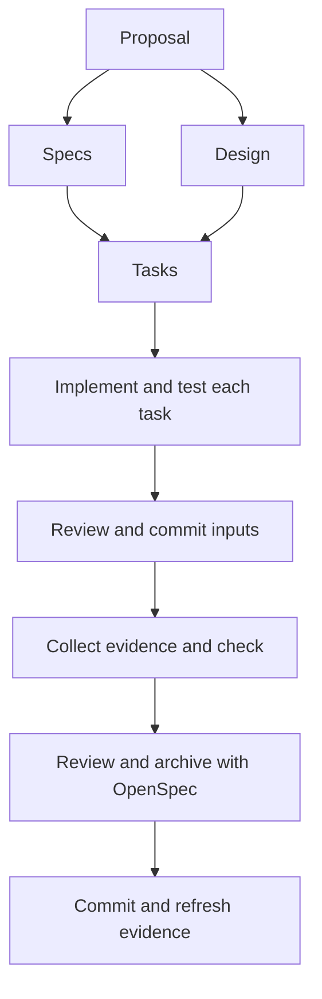

# From proposal to archive

Choose `cliewen-delivery` when you understand the problem and are ready to specify and implement a change. OpenSpec uses one schema per change. The default schema in `openspec/config.yaml` applies to new changes; changing it does not rewrite an existing change's schema selection.

## What writes each file?

| Step | Tool or person | Result |
|---|---|---|
| Initialize | OpenSpec, then Cliewen CLI | Project structure, installed schema, templates, and config |
| Plan | You and your coding agent | Proposal, delta specs, design, and tasks |
| Allocate IDs | Cliewen CLI | Persistent registry entries used in scenarios and test titles |
| Implement | Coding agent or developer | Code, tests, and relevant documentation |
| Review and commit | Developer and Git | Reviewed inputs at a clean revision |
| Collect evidence | Reference test adapter | Execution report for that revision |
| Check | Cliewen CLI | Installation and evidence findings |
| Archive | OpenSpec | Permanent specs and an archived change |

Specs and design both depend on the proposal. Tasks depend on both. Implementation starts after the tasks artifact exists; it does not require a test report before code has been written.

## Write a concrete request

Describe the desired behavior and where you want the agent to stop. The installed schema provides the method guidance. For example:

> Create a change proposal for CSV export with a header, explicit column order, escaped commas and quotation marks, and header-only output for an empty list. Use the existing change `add-csv-export`. Stop after proposal, specs, design, and tasks so I can review them before implementation.

Review the input scope, scenarios, and task checks. Once you are satisfied, authorize implementation. With the defaults, every implementation task gets its relevant tests and must pass before the next task begins. Set `testing.approach: tdd` to request the test-first cycle described in [configuration](../configuration.md#test-driven-development).

## Keep durable explanations useful

Use `docs/` for explanations that still matter after archive. A small formatter may need only a README API example. A choice that constrains future work may need a Decision Record created from `.cliewen-openspec/templates/decision.md`. Agent-authored choices start proposed; human agreement permits acceptance.

Use embedded Mermaid when it explains a structure or flow more clearly than prose alone. The alpha guides the agent to maintain diagrams, but does not parse your project's Mermaid or validate document frontmatter.

Plans are optional. If Jira or another ticket system owns scheduling and status, link to it. Keep independent design and decision content in the repository without duplicating ticket status.

## Review evidence before archive

A passing `check` confirms that the configured report matches the scenario references and current clean Git revision, with no blocking findings. Review the assertions as well: a test that only checks that an output exists may not prove the scenario.

Cliewen's instruction to check evidence is guidance. The alpha does not intercept OpenSpec's archive command. After archive, commit the new state and regenerate evidence before checking permanent specs. The [first-change guide](getting-started.md#7-archive-and-refresh-evidence) shows the commands.
