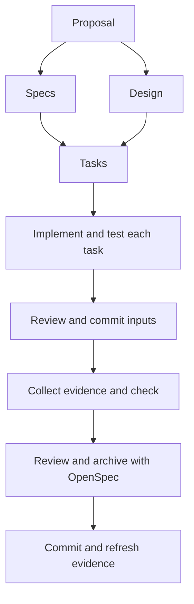

# From proposal to archive

Choose `cliewen-delivery` when you understand the problem and are ready to specify and implement a change. OpenSpec uses one schema per change. The default schema in `openspec/config.yaml` applies to new changes; changing it does not rewrite an existing change's schema selection.

## What writes each file?

| Step | Tool or person | Result |
|---|---|---|
| Initialize | OpenSpec, then Cliewen CLI | Project structure, installed schema, templates, and config |
| Plan | You and your coding agent | Proposal, delta specs, design, and tasks |
| Allocate IDs | Cliewen CLI | Persistent registry entries used in scenarios and test titles |
| Implement | Coding agent or developer | Code, tests, and relevant documentation |
| Review and commit | Developer and Git | Reviewed inputs at a clean revision |
| Collect evidence | Reference test adapter | Execution report for that revision |
| Check | Cliewen CLI | Installation and evidence findings |
| Archive | OpenSpec | Permanent specs and an archived change |



Specs and design both depend on the proposal. Tasks depend on both. Implementation starts after the tasks artifact exists; it does not require a test report before code has been written.

## Write a concrete request

Describe the desired behavior and where you want the agent to stop. The installed schema provides the method guidance. For example:

> Create a change proposal for CSV export with a header, explicit column order, escaped commas and quotation marks, and header-only output for an empty list. Use the existing change `add-csv-export`. Stop after proposal, specs, design, and tasks so I can review them before implementation.

Review the input scope, scenarios, and task checks. Once you are satisfied, authorize implementation. With the defaults, every implementation task gets its relevant tests and must pass before the next task begins. Set `testing.approach: tdd` to use the [task metadata, test-first recorder, and completion checks](../configuration.md#test-driven-development). Review each exception reason with the task plan and start recording before task edits.

## Keep durable explanations useful

Code comments should explain intent, constraints, or surprising behavior rather than repeat the code. Commit messages should summarize the concrete change, with rationale or consequences in the body when useful. Adapt examples and diagrams to the format; a short comment or commit message rarely needs a diagram. Preserve code behavior, structured data, required syntax, and exact identifiers when editing.

The schema's writing guidance applies to all text the agent creates or edits, including proposals, specs, tasks, plain-text files, Markdown, code comments, docstrings, commit messages, pull-request descriptions, user-facing messages, and conversational replies. Adapt the explanation to the intended reader and format without assuming knowledge of the conversation. Start change descriptions with the problem, resulting behavior, and practical impact. Use plain language and concrete examples. Keep the overview brief and link to supporting detail while preserving requirements, important exceptions, and required artifact sections.

Give references descriptive names, such as "ADR-025: Keep exports synchronous", and explain why they matter when needed. Avoid bare IDs, repeated explanations, and generic background. PR descriptions also include relevant validation and limitations. Apply the diagram guidance below across these texts. These are agent instructions, not automated writing checks; unrelated agent sessions and external PR tools need their own project instructions.

Write natural prose using the fewest words that preserve meaning and required detail. This guidance applies whether or not a writing skill is available. Automatic Humanizer detection and installation suggestions are planned; the alpha does not implement them.

Use `docs/` for explanations that still matter after archive. A small formatter may need only a README API example. A choice that constrains future work may need a Decision Record created from `.cliewen-openspec/templates/decision.md`. Agent-authored choices start proposed; human agreement permits acceptance.

Use embedded Mermaid when it explains a structure or flow more clearly than prose alone, such as a request sequence, state transitions, or dependencies. Include a short explanation of the diagram's main point and maintain it with the surrounding text. Mermaid guidance is enabled by default through `features.mermaid`.

Prefer an informative illustration or diagram when it replaces a longer explanation. Give it a short caption or accessible description, and avoid repeating every detail in prose.

For file and directory trees, a plain-text code block is often easier to read:

```text
docs/
|-- architecture/
|-- decisions/
`-- testing/
```

ASCII and plain-text sketches are also useful for small flows such as `Request -> Validate -> Export`, or where Mermaid rendering is unavailable. Choose the clearest representation for the reader and maintain one version of each diagram. A diagram is optional when prose or a table explains the subject clearly.

The alpha guides the agent to maintain diagrams, but does not parse your project's Mermaid or validate document frontmatter. Disabling Mermaid guidance does not prevent plain-text examples.

Plans are optional. If Jira or another ticket system owns scheduling and status, link to it. Keep independent design and decision content in the repository without duplicating ticket status.

## Review evidence before archive

The development source for 0.2 also checks [test quality and lifecycle](../testing/test-quality.md). Coverage, effectiveness, and lifecycle default to advisory review; use configuration to disable or enforce each independently. These settings are unavailable in the published 0.1 alpha. Preserve useful assertions through refactoring and accepted behavior changes, and remove obsolete ones only after explicit criterion retirement.

A passing `check` confirms that the configured report matches the scenario references and current clean Git revision, with no blocking findings. Review the assertions as well: a test that only checks that an output exists may not prove the scenario.

Cliewen's instruction to check evidence is guidance. The alpha does not intercept OpenSpec's archive command. After archive, commit the new state and regenerate evidence before checking permanent specs. The [first-change guide](getting-started.md#7-archive-and-refresh-evidence) shows the commands.
